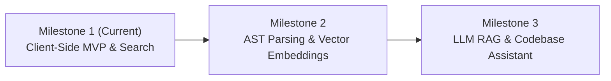

# FORGE

> **Your codebase, understood.**  
> An AI-powered codebase assistant workspace designed to help developers explore projects, ask better questions, and understand how their code works.

[](#roadmap)
[](#tech-stack)
[](#tech-stack)
[](#license)

---

## Overview

Software projects grow complex rapidly. Understanding an unfamiliar codebase or tracing execution across dozens of files requires hours of manual cross-referencing.

**FORGE** is being developed as an intelligent developer workspace that bridges the gap between raw source files and architectural comprehension.

This repository contains **Milestone 1 (MVP)**: a focused, high-performance client-side developer workspace featuring privacy-first local file ingestion, project metrics, an in-memory code inspector, and a fast keyword search assistant.

---

## Milestone 1 Features (Implemented)

* **Original Developer Workspace UI:**
  * Dark charcoal palette with restrained indigo accents, hairline borders, and subtle glassmorphism.
  * Inter typography paired with JetBrains Mono for code elements.
  * Custom geometric prism SVG branding and Lucide icons.
  * Responsive, zero-clutter layout optimized for developer workflows.

* **Client-Side Code Ingestion:**
  * Multi-file importer supporting `.js`, `.jsx`, `.ts`, `.tsx`, `.java`, `.py`, `.html`, `.css`, `.json`, `.md`.
  * Drag-and-drop file ingestion directly in the browser sandbox.
  * Built-in **Sample Project Loader** (TypeScript, JavaScript, Python, JSON, Markdown) for instant one-click demonstration.

* **Project Overview & Real-Time Metrics:**
  * Real-time metrics computed directly from loaded code: Total Files, Total Lines of Code (LOC), Memory Footprint, and Language Breakdown.
  * Editable project title with instant session updates.
  * File-removal controls and full workspace selection reset.

* **Interactive Code Viewer:**
  * Dark code inspector overlay with line numbers.
  * Syntax and metadata indicators (line count, file size, language badge).
  * One-click clipboard copy with visual feedback.

* **Local Code Search Assistant (Preview):**
  * Keyword and token matching engine searching across all ingested files.
  * Line-by-line snippet extraction with line numbers (`L14`) and match context.
  * Match ranking by keyword occurrences.
  * Transparent disclosure: operates entirely in client memory without mock AI responses or third-party cloud APIs.

* **Session Activity Audit Log:**
  * Verifiable timeline recording genuine user interactions in the active session (file imports, removals, keyword searches, renames).
  * Filter by event category and reset controls.

* **Project Inventory & Manifest Export:**
  * Export structured project metadata and file manifests (`.json`) for downstream toolchains.

* **System Settings & Honest Roadmap Navigation:**
  * System diagnostics detailing sandbox memory and runtime status.
  * Honest modal placeholders for planned features (no fake working features).

---

## Architectural Principles & Scope

In accordance with the Milestone 1 technical specification:

* **Zero Mock Facades:** All metrics, search results, and activities reflect actual data in memory.
* **No Premature Backend:** No database, authentication, embeddings, vector database, or LLM APIs are introduced in this milestone.
* **Privacy by Default:** Ingested source code never leaves the local browser session.

---

## Engineering Roadmap



### Milestone 1: Client-Side MVP *(Current)*
- [x] Vite + React 19 + Tailwind CSS v4 foundation
- [x] Multi-file code ingestion engine
- [x] Local keyword and token search assistant
- [x] Code viewer modal with line numbers
- [x] Real-time metrics and session audit trail
- [x] Project manifest export

### Milestone 2: AST Analysis & Local Retrieval *(Planned)*
- [ ] Tree-sitter / Babel AST parser for symbol and dependency graph extraction
- [ ] Client-side vector embeddings with WebAssembly (Wasm) indexer
- [ ] Hybrid dense/lexical search
- [ ] Direct GitHub repository ingestion via API

### Milestone 3: AI Assistant & Conversational RAG *(Planned)*
- [ ] Configurable LLM provider integration (Claude, Gemini, OpenAI)
- [ ] Retrieval-Augmented Generation (RAG) conversational codebase assistant
- [ ] Automated architectural diagram generator (Mermaid)
- [ ] Technical interview question and test case generator

---

## Tech Stack

| Layer | Technology |
|---|---|
| **Framework** | [React 19](https://react.dev/) |
| **Build Tool** | [Vite 8](https://vite.dev/) |
| **Styling** | [Tailwind CSS v4](https://tailwindcss.com/) with `@tailwindcss/vite` |
| **Icons** | [Lucide React](https://lucide.dev/) |
| **Typography** | Inter & JetBrains Mono (Google Fonts) |
| **State Management** | React Context (`WorkspaceContext`) |

---

## Project Structure

```
Forge/
├── public/                  # Static assets & favicons
├── src/
│   ├── components/          # Reusable workspace components
│   │   ├── CodeViewerModal.jsx    # Full-screen code inspector with line numbers
│   │   ├── Header.jsx             # Top bar with stats and repo link
│   │   ├── PlaceholderModal.jsx   # Honest roadmap placeholders
│   │   └── Sidebar.jsx            # Brand logo, navigation & active project
│   ├── constants/           # Configurations & sample files
│   │   ├── fileTypes.js           # Supported extensions and badge themes
│   │   └── sampleProject.js       # Pre-packaged multi-language sample project
│   ├── context/
│   │   └── WorkspaceContext.jsx   # Ingestion, search, metrics, and activity state
│   ├── views/               # Page-level views
│   │   ├── ActivityView.jsx       # Real session event audit trail
│   │   ├── ProjectsView.jsx       # Project inventory & manifest exporter
│   │   ├── SettingsView.jsx       # System specs and roadmap comparison
│   │   └── WorkspaceView.jsx      # Primary workspace, overview & search
│   ├── App.jsx              # Root application layout
│   ├── index.css            # Tailwind CSS v4 imports & scrollbars
│   └── main.jsx             # React entrypoint
├── index.html               # Semantic HTML5 shell with Google Fonts
├── package.json             # Scripts & dependencies
├── vite.config.js           # Vite configuration with Tailwind plugin
└── README.md                # Project documentation
```

---

## Getting Started

### Prerequisites

* **Node.js**: v18.0.0 or higher (v22+ recommended)
* **npm**: v9.0.0 or higher

### Installation

1. Clone the repository:
   ```bash
   git clone https://github.com/AnishPatra04/Forge.git
   cd Forge
   ```

2. Install dependencies:
   ```bash
   npm install
   ```

3. Launch the local development server:
   ```bash
   npm run dev
   ```

4. Open your browser and navigate to:
   ```
   http://localhost:5173
   ```

### Production Build

To verify and produce an optimized production bundle:

```bash
npm run build
```

To preview the production build locally:

```bash
npm run preview
```

---

## Verification & Testing

The application has been verified against the following checks:
* Clean production build without warnings (`npm run build`).
* Multi-file ingestion across `.ts`, `.js`, `.py`, `.json`, `.md`.
* Accurate real-time metric computation (LOC, size, file count).
* Keyword search accuracy and snippet rendering.
* Full navigation across Workspace, Projects, Activity, and Settings.
* Zero external network dependencies or telemetry.

---

## License

This project is licensed under the [MIT License](LICENSE).
